# Конспект: Процессор и рабочий цикл процессора

## Часть 1. Процессор: теория («проц теория.ppt»)

### 1. Элементы процессора

**Состав процессора:**
- дешифратор команд;
- операционные устройства (в т.ч. АЛУ);
- устройство управления;
- регистры;
- транслятор адресов операндов;
- шины.

**Схема связей:**
- КОП поступает в дешифратор команд;
- устройство управления связано с операционными устройствами, регистрами и транслятором адресов;
- внутренняя шина связывает блоки процессора;
- внешняя шина обеспечивает обмен с памятью и периферией.

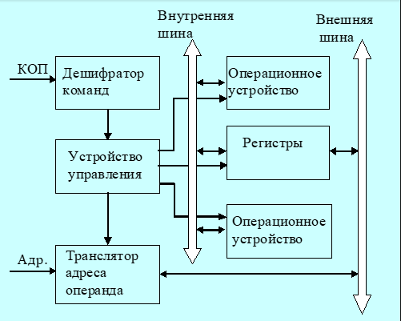

**Типичный микропроцессор:**
- входы/выходы: адресация, данные, управление шиной, арбитраж шины, состояние, прерывания;
- питание: +5 В;
- тактовая частота.

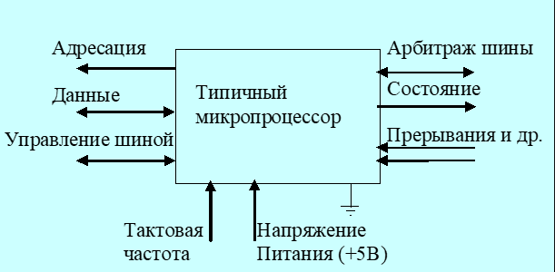

**Историческая справка:**
- 1971 г. — первый микропроцессор Intel 4004;
- вычислительная мощность как у ENIAC;
- стоимость около 200 долларов;
- 2300 транзисторов;
- тактовая частота 108 кГц.

---

### 2. Операционные устройства

**Виды операционных устройств:**
- целочисленная арифметика;
- логические операции;
- операции сдвига;
- десятичная арифметика;
- числа с плавающей запятой;
- графические операции.

**Структурный базис:**
- регистры — хранение слов данных;
- шины — передача слов данных;
- комбинационные схемы — вычисления по управляющим сигналам.

#### Регистры

Регистр — линейка триггеров, имеющих входы для изменения состояния.

**Классификация регистров:**
- программно-видимые явно;
- видимые косвенно («теневые» регистры дескрипторов сегментов);
- внутренние для специальных целей (регистр адреса памяти, регистр данных);
- внутренние для хранения промежуточных результатов.

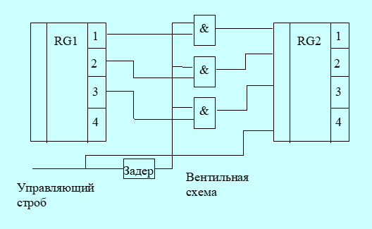

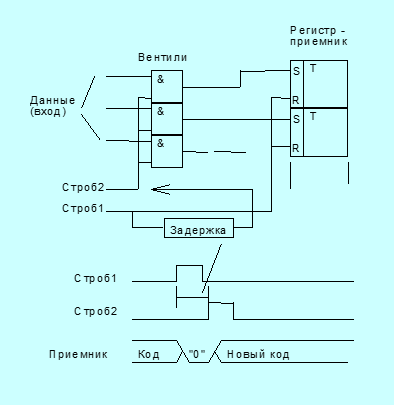

#### АЛУ

АЛУ — комбинационная схема, не содержащая элементов памяти. Принимает два операнда, формирует результат.

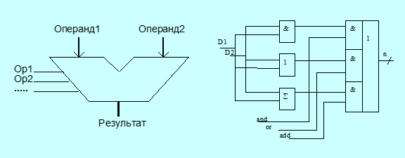

**Принципиальная схема АЛУ:**
- логическое устройство;
- полный сумматор;
- декодер операции.

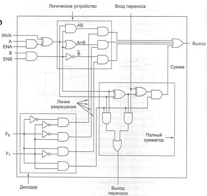

**Многоразрядное АЛУ:**
- каскад 1-битных АЛУ;
- входы A0…A7, B0…B7;
- выходы O0…O7;
- вход переноса, выход переноса.

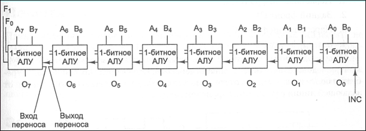

**Простейшие операционные устройства:**
- пересылка `mov R1, R2`;
- сдвиг `rol R0`;
- сложение `add R0, R1`.

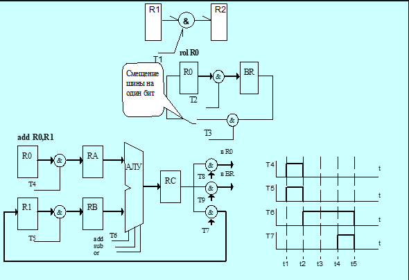

**Связь операционных устройств с шиной:**
- модель фон Неймана;
- регистры A, B;
- входные регистры АЛУ;
- выходной регистр АЛУ.

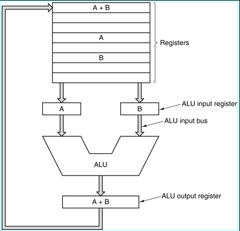

**Магистральное операционное устройство:**
- узел РОН;
- мультиплексоры A и B;
- магистрали A, B, C;
- ОПБ — операционный блок.

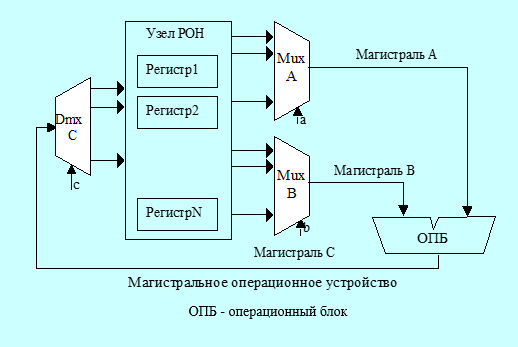

**Типы операционных устройств с магистральной структурой:**
- трёхмагистральное ОПУ;
- двухмагистральное ОПУ;
- одномагистральное ОПУ.

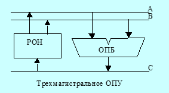
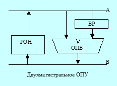
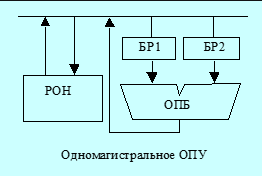

---

### 3. Устройство управления

**Функции УУ:**
- выборка очередной команды из ОЗУ;
- дешифрация кода операции;
- формирование адресов операндов;
- выборка операндов;
- передача операндов в операционное устройство;
- выполнение операции;
- запись результата в ОЗУ;
- инициирование ввода/вывода;
- реакция на прерывания.

**Модель устройства управления:**
- регистр команд;
- флаги;
- тактовые импульсы;
- микропрограммный автомат;
- внутренние сигналы управления;
- сигналы в системную шину и из неё.

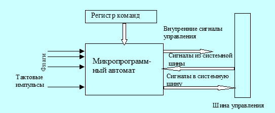

**Основные понятия:**
- **микрооперация** — элементарное действие за один такт;
- **микрокоманда** — совокупность одновременно выполняемых микроопераций;
- **микропрограмма** — последовательность микрокоманд, определяющая машинный цикл.

**Состав УУ:**
- управляющая часть: регистр команды, микропрограммный автомат, дешифратор команд, узел прерываний и приоритетов;
- адресная часть: операционный узел УУ, регистр адреса, счётчик команд.

#### Микропрограммный автомат с жёсткой логикой

- выходные сигналы формируются однажды соединёнными логическими схемами;
- КОП определяет последовательность сигналов;
- сигналы привязаны к импульсам синхронизации;
- счётчик тактов сбрасывается по окончании цикла команды;
- на каждом такте своя микрокоманда;
- флаги влияют на выработку сигналов.

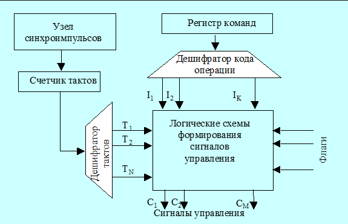

#### Микропрограммный автомат с программируемой логикой

- идея предложена Морисом Уилксом в 1951 г.;
- три уровня выполнения команд: команда → микропрограмма → сигналы управления;
- есть память микропрограмм;
- каждой команде соответствует микропрограмма;
- к 70-м годам идея стала преобладающей;
- в современных процессорах от неё частично отказались из-за снижения аппаратных затрат и роста производительности.

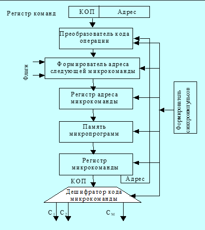

**Пример процессора с тремя шинами:**
- микрокоманда GATE;
- микрокоманда TEST;
- микропамять;
- нанопамять;
- одноуровневая и двухуровневая реализация.

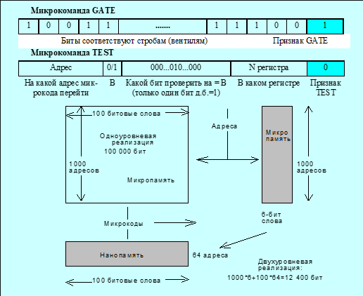

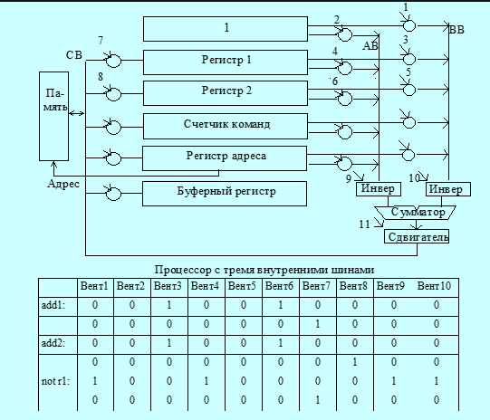

---

### 4. Команды. Архитектуры системы команд

**Виды архитектур:**
- стековая;
- аккумуляторная;
- регистровая;
- с выделенным доступом к памяти.

#### Стековая архитектура

- стек работает по принципу LIFO;
- операции `push` и `pop`;
- запись только в верхнюю ячейку;
- стек может быть программным или аппаратным;
- используется обратная польская запись (постфиксная форма).

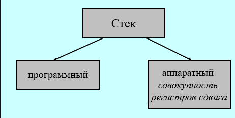

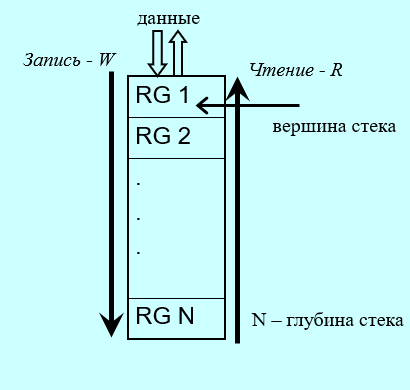

#### Аккумуляторная архитектура

- аккумулятор хранит результат и один из операндов;
- второй операнд считывается из памяти в регистр данных;
- команды `load x` и `store x`;
- достоинства: короткие команды, простота декодирования;
- недостаток: частые обращения к памяти.

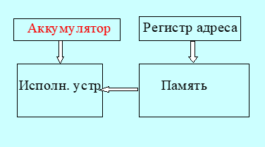

#### Регистровая архитектура

- регистровый файл, РОН;
- размер регистров обычно равен машинному слову;
- CISC — мало РОН, RISC — много РОН;
- подвиды команд: регистр-регистр, регистр-память, память-память;
- достоинства: компактность кода, высокая скорость;
- недостаток: более длинные инструкции.

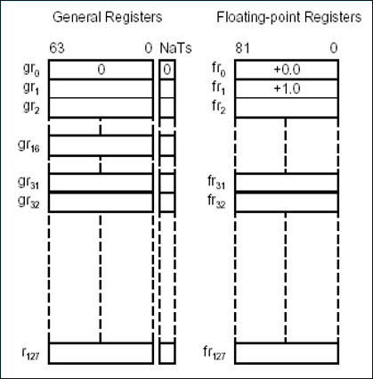

#### Архитектура с выделенным доступом к памяти

- обращение к памяти только через `load` и `store`;
- операнды в командах обработки — только в регистрах;
- характерна для RISC;
- длина команд обычно 32 бита, трехадресный формат;
- примеры: Sun SPARC, MIPS R10000, DEC Alpha, PowerPC.

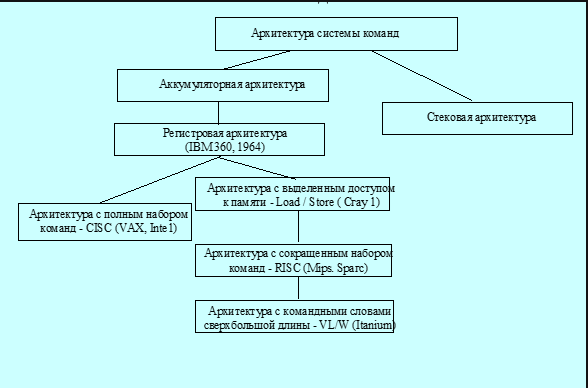

---

### 5. Конфигурируемые процессоры Xtensa

- Tensilica Xenergy — САПР для оценки энергопотребления;
- позволяет оценить влияние конфигурации процессора на потребление;
- можно менять конфигурацию ядра, добавлять расширения команд, регистровые файлы, специализированные модули;
- оптимизация прикладного кода по мощности.

---

### 6. Процессор Intel 8086

**Структурная схема:**
- устройство обработки;
- устройство сопряжения с шиной;
- очередь команд;
- регистры данных и адреса: `ax, bx, cx, dx; si, di, sp, bp`;
- сегментные регистры: `cs, ss, ds, es`;
- указатель команд `ip`;
- сумматор адреса;
- регистр флагов `fl`.

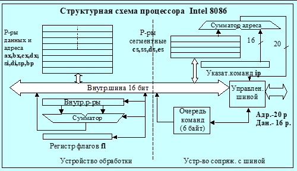

**Регистр флагов 8086:**
- CF — перенос;
- PF — чётность;
- AF — вспомогательный перенос;
- ZF — ноль;
- SF — знак;
- TF — прерывание для отладки;
- IF — разрешение прерывания;
- DF — направление цепочечных команд;
- OF — переполнение.

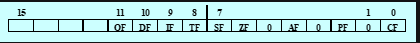

**Конвейер. Организация памяти. Сегментация:**
- сегментный регистр;
- исполнительный адрес = сегмент × 16 + смещение;
- физический адрес 20 бит;
- `cs` — сегмент кода;
- `ds` — сегмент данных;
- `ss` — сегмент стека;
- `es` — дополнительный сегмент;
- модели памяти: Tiny, Small, Medium, Compact, Large, Huge.

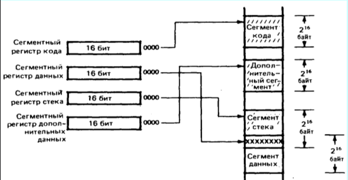

**Форматы команд i8086:**
1. КОП, w, reg, данные;
2. КОП, s, w, постбайт, данные;
3. КОП, d, w, постбайт, смещение;
4. КОП, w, d, млб адр, стб адр;
5. КОП, v, w, постбайт, сдвиги;
6. КОП, условие, смещение;
7. КОП, смещение;
8. КОП, порт, смещение.

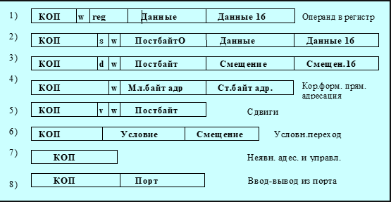

**Особенности команд i8086:**
- CISC-архитектура;
- всего 538 команд;
- базовая структура — двухоперандная;
- длина команды от 1 до 15 байтов;
- сложные форматы кодирования;
- многокомпонентные способы адресации;
- неортогональная регистровая модель;
- команды пересылки не изменяют признаки.

---

## Часть 2. Рабочий цикл процессора («проц.pptx»)

### 1. Общие сведения

- программа — последовательность команд;
- команды и данные хранятся в оперативной памяти;
- команды выполняет процессор;
- системная шина связывает ЦП, ОП и контроллер.

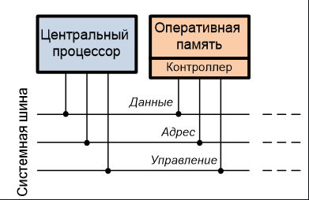

**Представление данных:**
- двоичная система счисления;
- знак: 0 — положительное, 1 — отрицательное;
- символы — двоичные коды;
- двоичные вектора — последовательности битов.

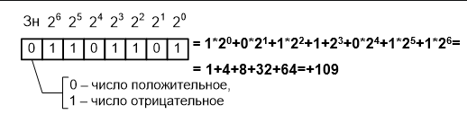

**Представление команд:**
- команда содержит код операции и адреса операндов;
- пример формата: КОП | адрес первого операнда | адрес второго операнда.

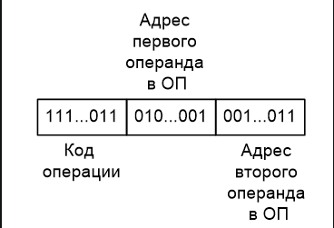

**Система команд:**
- арифметические, логические, пересылки, передачи управления, ввода-вывода;
- пример: КМ1816ВЕ51.

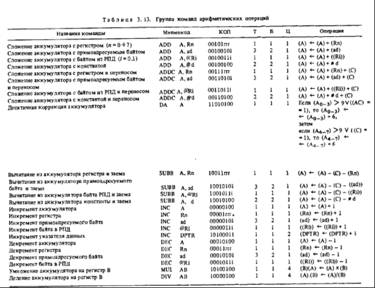

---

### 2. Аппаратное обеспечение

**Основные блоки:**
- процессор;
- оперативная память;
- шина адреса;
- шина данных;
- шина управления.

**Регистры процессора:**
- РК — регистр команд;
- ПортА — порт адреса;
- ПортД — порт данных;
- P1 — аккумулятор АЛУ;
- P2 — второй регистр АЛУ;
- СчАК — счётчик адреса команды.

**Регистры ОП:**
- РАОП — регистр адреса ОП;
- РСОП — регистр слова ОП.

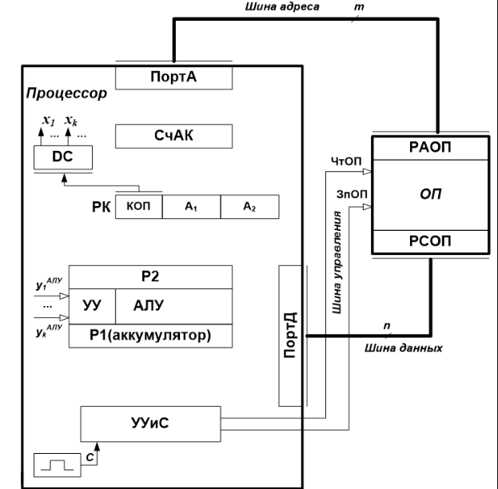

**Пояснения:**
- УУиС — устройство управления и синхронизации;
- СчАК хранит адрес очередной команды;
- РК хранит выбранную команду;
- АЛУ имеет два регистра операндов, один из них аккумулятор;
- ПортА подключён к шине адреса;
- ПортД подключён к шине данных.

**Чтение и запись ОП:**
- для чтения: адрес в РАОП, сигнал ЧтОП, данные в РСОП;
- для записи: адрес в РАОП, данные в РСОП, сигнал ЗпОП.

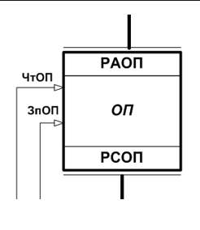

---

### 3. Рабочий цикл процессора

**Пример двухадресной арифметической команды:**
- формат: КОП | A1 | A2.

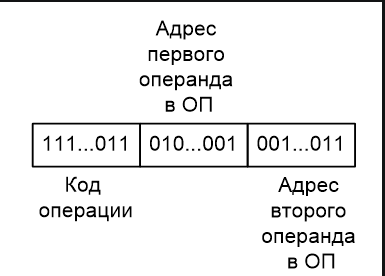

#### Этап 1. Выборка команды из ОП

1. `y1: ПортА := СчАК`
2. `y2: ЧтОП`
3. `y3: РК := ПортД`

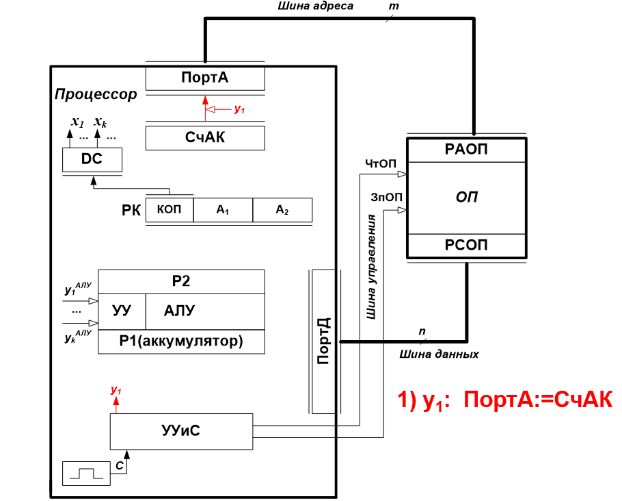
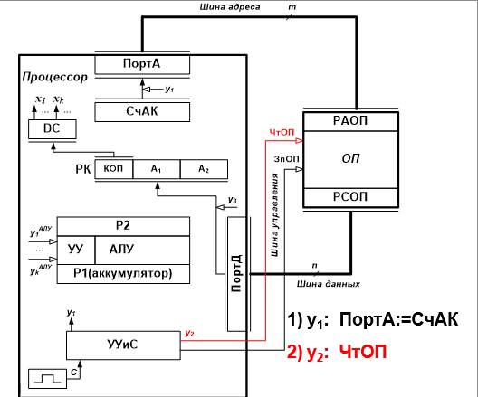
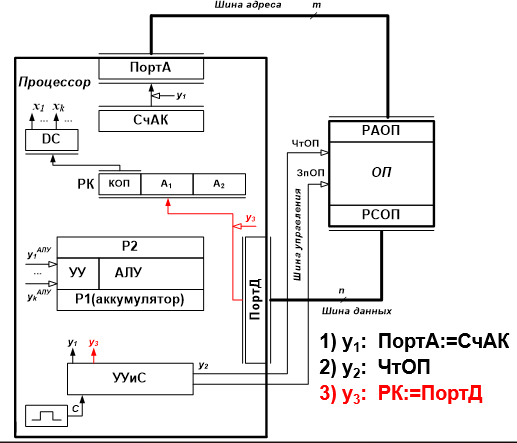

#### Этап 2. Выборка операндов из ОП

**2.1. Первый операнд:**
4. `y4: ПортА := A1`
5. `y2: ЧтОП`
6. `y5: P1 := ПортД`

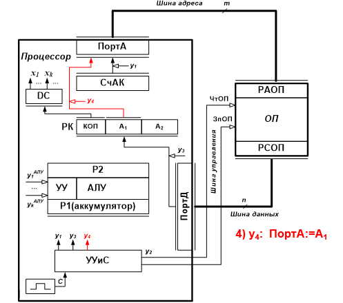
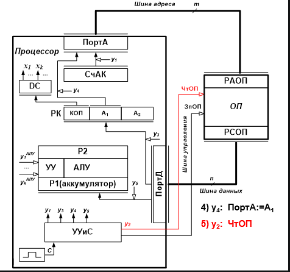
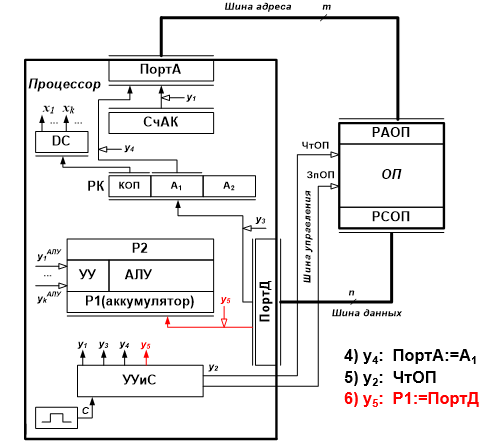

**2.2. Второй операнд:**
7. `y6: ПортА := A2`
8. `y2: ЧтОП`
9. `y7: P2 := ПортД`

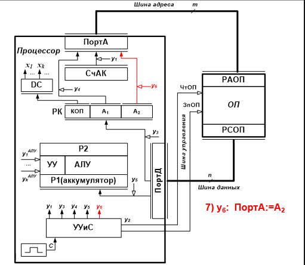
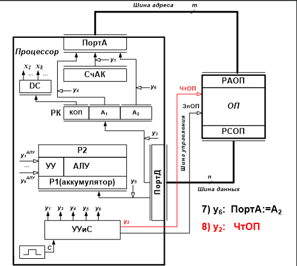
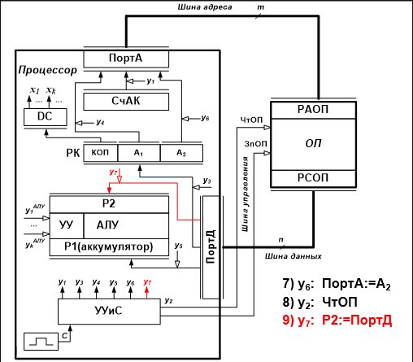

#### Этап 3. Выполнение операции в АЛУ

10. `КОП → DC → xi → УУиС → yi → АЛУ`

АЛУ выполняет микропрограмму, результат помещается в аккумулятор P1.

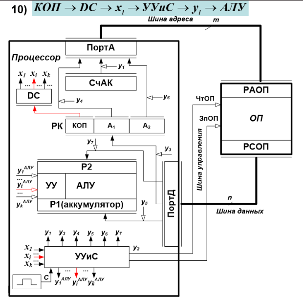

#### Этап 4. Запись результата в ОП

11. `y8: ПортД := P1`
12. `y4: ПортА := A1`
13. `y9: ЗпОП`

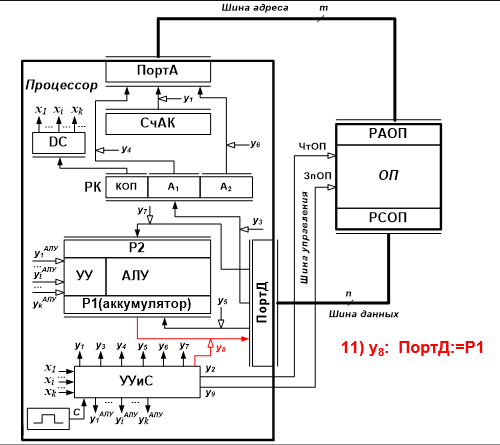
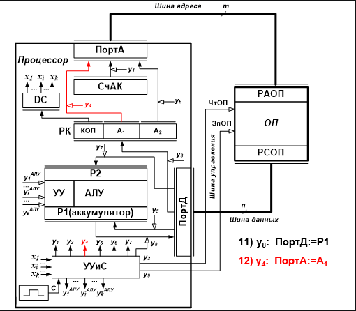
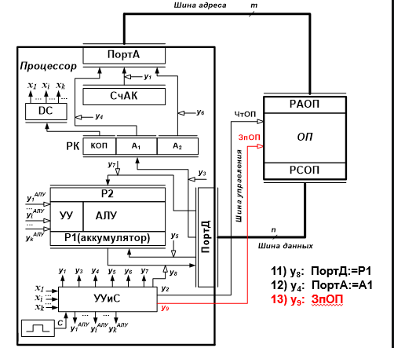

#### Этап 5. Продвижение СчАК

14. `y10: СчАК += L`

где `L` — длина выполненной команды в байтах.

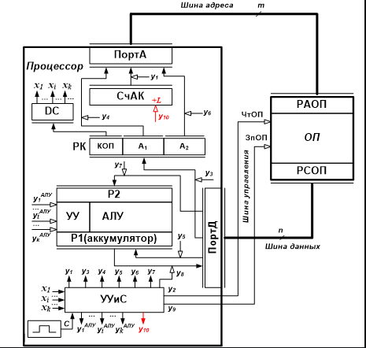

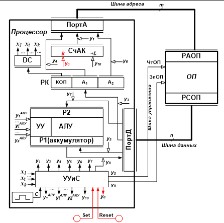

**Обобщённое УГО процессора:**
- выводы порта адреса A;
- выводы порта данных D;
- RD, WR — чтение и запись для ОП;
- IN, OUT — чтение и запись для периферии;
- RESET, SET, CLC, GND, +5V.

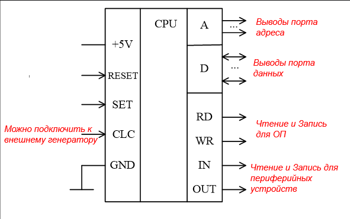

**Микропрограмма работы процессора:**
- повторение этапов рабочего цикла;
- последовательность управляющих сигналов `y0, y1, y2, ...`.

---

### 4. Уточнение АЛУ и признаков результата

- выход `Z_АЛУ` (ШАЛУ(8)) — «занято/свободно»;
- признаки результата:
  - ШАЛУ(0)=1, если P1=0;
  - ШАЛУ(1)=1, если P1<0;
  - ШАЛУ(2)=1, если P1>0;
  - ШАЛУ(3)=1 — переполнение с фиксированной точкой;
- шифратор преобразует унитарный код в 2-битный код РПР;
- флаги исключительных ситуаций:
  - ШАЛУ(4) — переполнение порядка;
  - ШАЛУ(5) — исчезновение порядка;
  - ШАЛУ(6) — потеря значимости;
  - ШАЛУ(8) — деление на ноль;
- РФ — регистр флагов прерываний;
- РПР — регистр признака результата.

**Команды перехода:**
- условный переход по маске;
- формат: КОП | МАРК;
- маска задаёт условие перехода;
- если условие выполнено, СчАК замещается адресом перехода A;
- иначе выполняется следующая команда.

---

### 5. Прерывания

**Аппаратная поддержка:**
- регистр флагов РФ;
- регистр масок РМ;
- указатель стека УС;
- таблица векторов прерываний (ТВП) в ОП.

**Обработка прерывания:**
1. `ОП[УС] := СК; УС := УС + 1;`
2. `СК := i;`
3. выполняется `JMP Ai`;
4. выполняются команды программы обработки прерывания;
5. `RETI`: `УС := УС - 1; СК := ОП[УС];`

**Типы прерываний:**
- исключения (деление на ноль, переполнение и т.п.), обычно не маскируются;
- внешние прерывания (клавиатура, таймер, ввод/вывод), могут маскироваться.

**Мультипрограммный режим:**
- каждой программе выделяется квант времени;
- по прерыванию от таймера процессор переключается на другую программу;
- возврат — в точку прерывания.

**Аппаратная поддержка системы прерываний:**
- РФ — регистр флагов прерываний;
- РМ — регистр масок;
- ТВП — таблица векторов прерываний;
- стек для сохранения адреса возврата.

**Алгоритм обработки прерывания:**
1. сохранение СК в стек;
2. загрузка в СК адреса вектора;
3. выполнение `JMP Ai`;
4. выполнение программы обработки;
5. `RETI` — возврат.

**Недостаток векторных систем:**
- сохраняется только адрес возврата;
- программист должен сам сохранять РСФ и РОН;
- в некоторых системах сохраняется «Слово состояния программы» (ССП/PSW).