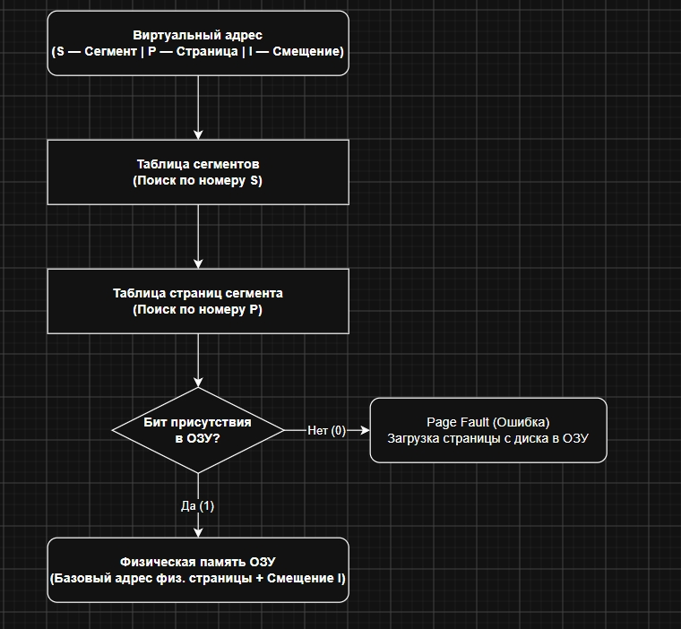

# Управление памятью в ЭВМ

## 1. Иерархическая организация памяти в ЭВМ

Современные компьютеры используют многоуровневую систему хранения данных, которая позволяет находить баланс между скоростью доступа, емкостью и стоимостью памяти в расчете на один бит.

- **Кэш-память (регистровая и уровни L1, L2):** Сверхбыстрая память, расположенная на процессоре или непосредственно рядом с ним. К ней центральный процессор (ЦП) может обращаться напрямую. Она имеет наименьший объем, но максимальную скорость работы и наибольшую стоимость единицы информации.
- **Основная (первичная) память (ОЗУ / RAM):** Энергозависимая память на полупроводниковых чипах. Используется для временного хранения программ и данных, с которыми процессор работает в текущий момент. Обмен данными с процессором идет через системную шину.
- **Внешняя (вторичная) память (ВЗУ):** Энергонезависимые накопители большой емкости (жесткие диски HDD, SSD, оптические и магнитооптические диски, магнитные ленты). Чтобы процессор мог обратиться к данным на ВЗУ, их необходимо предварительно скопировать в основную память.

### Классификация запоминающих устройств

**Электронные схемы:**

- **ОЗУ (RAM):** энергозависимая память для записи, считывания и хранения программ и данных. Делится на статическую (SRAM — массивы триггеров) и динамическую (DRAM — массивы конденсаторов).
- **ПЗУ (ROM):** энергонезависимая память «только для чтения». Сохраняет данные независимо от подачи питания. Хранит критически важный код, например, BIOS (базовую систему ввода-вывода).
- **CMOS / КМОП-память:** энергонезависимая память на полупроводниках для хранения системных настроек.

**Накопители информации:**

- магнитные диски (HDD, гибкие диски);
- магнитные ленты (стримеры для резервного копирования);
- оптические диски (CD, DVD);
- флеш-накопители.

## 2. Структура и организация памяти

- **Бит** — минимальный элемент памяти (двоичный запоминающий элемент).
- **Машинное слово** — группа последовательно расположенных байтов (в современных ЭВМ обычно 4 байта / 32 бита или больше), с которой процессор работает как с единым целым.
- **Физическая организация ОП:** Линейная последовательность адресуемых ячеек (байт) с номерами (адресами) от 0 до некоторого максимального значения. Объем измеряется в килобайтах, мегабайтах, гигабайтах и терабайтах.

## 3. Функции ОС по управлению памятью

Мультипрограммная операционная система распределяет всю оперативную память, свободную от самой ОС. Основные задачи ОС:

- Отслеживание состояния свободной и занятой памяти.
- Выделение памяти процессам и ее освобождение при завершении процессов.
- Вытеснение процессов из оперативной памяти на диск (в виртуальную память / файл подкачки) при нехватке ОП и возврат их обратно в ОП при появлении места.
- Настройка адресов программы на конкретную область физической памяти (динамическое преобразование адресов).
- Защита памяти: предотвращение попыток выполняющегося процесса читать или записывать данные в память, выделенную другому процессу.

## 4. Стратегии управления памятью

Для эффективного распределения ресурсов ОП операционная система использует три стратегии:

- **Стратегия выборки (вталкивания):** определяет момент времени, когда очередной блок программы или данных следует переписать из внешней памяти в оперативную. Бывает по запросу (по требованию процесса) и упреждающая (основанная на свойствах последовательного выполнения кода и циклов).
- **Стратегия размещения:** определяет, в какое конкретное место первичной памяти поместить поступающий блок (например: «первый подходящий» участок, «наиболее подходящий» по объему или «наименее подходящий»).
- **Стратегия выталкивания (замещения):** решает, какой блок данных или сегмент следует удалить из ОП при ее полном заполнении, чтобы освободить место для приоритетных задач.

**Основные алгоритмы выталкивания:**

- Случайный выбор;
- FIFO (выталкивание первой пришедшей страницы);
- LRU (дольше всего не использовавшейся);
- LFU (реже всего используемой);
- NUR (не использовавшейся в последнее время).

## 5. Виды организации реальной памяти

- **Однопрограммная организация с

выделением непрерывной области одному пользователю:** проста в защите памяти, но неэффективна из-за простоя процессора и устройств ввода-вывода.
- **Мультипрограммная организация с фиксированными разделами:** ОП статически разбита на разделы фиксированного размера. Повышает загрузку ЦП, но порождает две проблемы:
  - **Внешняя фрагментация** (разделы слишком малы для крупных программ);
  - **Внутренняя фрагментация** (неиспользованные остатки внутри выделенных разделов).
- **Мультипрограммированная организация с динамическими (переменными) разделами:** память выделяется по запросу задачи в точно требуемом объеме. Устраняет внешнюю фрагментацию, но сохраняет внутреннюю.
- **Перемещаемые разделы:** метод борьбы с фрагментацией путем периодического «сжатия» памяти (копирование занятых разделов в сторону старших или младших адресов для объединения всей свободной памяти в единую область).

## 6. Концепция виртуальной памяти

Виртуальная память позволяет выполнять программы, размер которых превышает объем имеющейся физической оперативной памяти (РОП).

### Историческое развитие методов

- **Оверлейная структура:** ручное разбиение программистом большой программы на части (оверлеи), которые поочередно загружаются в общую область памяти по мере необходимости.
- **Свопинг (Swapping):** выгрузка процессов на диск и их возврат в оперативную память целиком.
- **Виртуальная память:** между оперативной памятью и диском динамически перемещаются отдельные части процессов (страницы или сегменты).

### Способы организации виртуальной памяти

- **Динамическая страничная организация:** виртуальное и физическое адресное пространство делятся на блоки фиксированного размера — страницы.
- **Сегментная организация:** программа разбивается на логические части переменной длины — сегменты.
- **Комбинированная сегментно-страничная организация:** виртуальное пространство делится на сегменты, а каждый сегмент делится на фиксированные страницы.
- **Двухуровневая страничная организация.**

## 7. Механизм динамического преобразования адресов (ДПА)

- **Символьные адреса** задаются программистом.
- **Виртуальные адреса** формируются транслятором (условные адреса, обычно считая от 0).
- **Физические адреса** соответствуют реальным номерам ячеек ОП, где находятся данные после запуска программы.

Процесс ДПА поддерживается на аппаратно-микропрограммном уровне и использует таблицы отображения блоков (таблицы страниц и сегментов), которые сопоставляют виртуальные номера с реальными физическими адресами или фиксируют факт выгрузки данных на диск.

